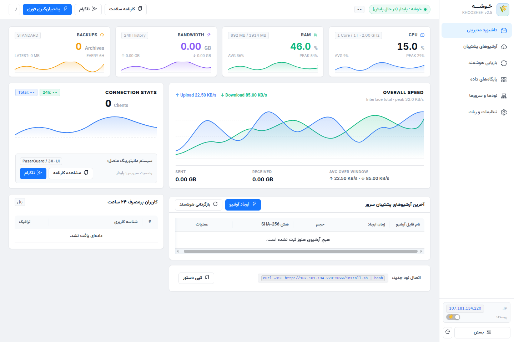

# 🌾 Khoosheh (خوشه)

<div align="center">



[](https://github.com/dalroot/khoosheh/releases)
[](https://opensource.org/licenses/MIT)
[](https://www.python.org/)
[](https://github.com/dalroot/khoosheh/actions)
[](https://github.com/dalroot/khoosheh/security)
[](https://github.com/dalroot/khoosheh)
[](SECURITY.md)
[](https://github.com/dalroot/khoosheh/pulls)
[](https://t.me/dallrep)

**ابزار بکاپ‌گیری خودکار، بازگردانی و انتقال پنل‌های پروکسی و سرورهای لینوکس بدون قطعی سرویس و با حفظ دقیق ترافیک کاربران**

[راهنمای فارسی](#-راهنمای-فارسی) • [English Guide](#-english-guide) • [ویژگی‌ها و تست‌ها](#-ویژگیها-و-نتایج-تست-عملیاتی) • [نصب سریع](#-نصب-سریع-یکخطی) • [پنل‌های پشتیبانی‌شده](#-پنلهای-پشتیبانیشده) • [ربات تلگرام](#-قابلیتهای-ربات-تلگرام) • [جامعه و پشتیبانی](#-جامعه-کاربری-و-پشتیبانی)

</div>

---

<div dir="rtl">

## 📖 راهنمای فارسی

پروژه **خوشه** یک ابزار سبک، مستقل و بدون پیش‌نیاز سنگین برای بکاپ‌گیری منظم و انتقال سریع پنل‌های پروکسی و سرورها است. این برنامه با استفاده از قابلیت بکاپ زنده SQLite (`WAL Checkpoint`)، بدون نیاز به خاموش کردن پنل یا ایجاد اختلال در ترافیک کاربران، فایل‌های پشتیبان را تهیه می‌کند و در صورت نیاز به تعویض سرور، امکان بازیابی کامل دیتابیس، اینباندها و گواهی‌ها را فراهم می‌سازد.

---

### ⚡ ویژگی‌ها و نتایج تست عملیاتی

* **حفظ کامل ترافیک و اطلاعات کاربران:** سهمیه مصرفی، حجم آپلود و دانلود، تاریخ انقضا و وضعیت اکانت‌ها دقیقاً همانند سرور مبدأ منتقل می‌شوند.
* **داون‌تایم حداقلی (کمتر از ۱ دقیقه):** فرآیند جابه‌جایی دیتابیس و سوئیچ به سرور جدید در کمترین زمان ممکن انجام می‌گیرد.
* **بازگردانی خودکار در کمتر از ۵ دقیقه:** بازگردانی دیتابیس به همراه بررسی سلامت فایل (`integrity_check`) و ری‌استارت سرویس‌ها به شکل خودکار و در چند دقیقه انجام می‌شود.
* **فشرده‌سازی و رمزگذاری:** فایل‌های بکاپ با فرمت فشرده 7z ذخیره شده و امکان تنظیم رمز عبور اختصاصی (AES-256) برای امنیت فایل‌ها وجود دارد.
* **استقبال از مشارکت:** این مخزن فعال است و از ارسال ایشو، پیشنهادات و پول‌ریکوئست‌ها (Pull Requests) استقبال می‌کنیم.

---

### 🖥️ پنل‌های پشتیبانی‌شده

خوشه مسیرهای استاندارد، سرویس‌ها و کانتینرهای پنل‌های زیر را شناسایی و پوشش می‌دهد:

#### ۱. پنل ۳X-UI و X-UI
* **فورک‌های تحت پوشش:** نسخه سنایی (`MHSanaei`)، علیرضا (`alireza0`)، فرانتس‌کافکا (`FranzKafkaYu`) و واکسیلو (`vaxilu`)
* **فایل‌ها و مسیرها:** فایل اصلی `/etc/x-ui/x-ui.db` به همراه کانفیگ‌های هسته Xray و گواهینامه‌های SSL
* **نوع دیتابیس:** SQLite با بکاپ‌گیری گرم و بدون قطعی

#### ۲. پنل مرزبان (Marzban)
* **نوع استقرار:** داکر کامپوز و سرویس مستقیم لینوکس
* **فایل‌ها و مسیرها:** فایل `/var/lib/marzban/db.sqlite3`، تنظیمات محیطی `.env`، تمپلت‌ها و استخراج دامپ داکر MySQL
* **نوع دیتابیس:** SQLite و دامپ داکر MariaDB/MySQL

#### ۳. پنل پاسارگاد (PasarGuard)
* **نوع استقرار:** کانتینر داکر و ساختار چندنودی
* **فایل‌ها و مسیرها:** دیتابیس `/var/lib/pasarguard/db.sqlite3`، تنظیمات پل سابسکریپشن `sub_bridge` و کلیدهای نودها
* **نوع دیتابیس:** SQLite

#### ۴. پنل رمنا و رمناویو (Remnawave)
* **نوع استقرار:** نسخه سابسکریپشن و هسته مرکزی
* **فایل‌ها و مسیرها:** دیتابیس `/opt/remna/database.sqlite`، فایل‌های `.env` و سرتیفیکیت‌ها
* **نوع دیتابیس:** SQLite و فایل‌های پشتیبان PostgreSQL

#### ۵. پنل هیدیفای منیجر (Hiddify Manager)
* **نوع استقرار:** پنل مدیریت هیدیفای
* **فایل‌ها و مسیرها:** فایل دیتابیس `hiddifypanel.db` و کانفیگ `current-config.json`
* **نوع دیتابیس:** SQLite

#### ۶. تانل‌ها و وب‌سرورها (Hawal & Nginx)
* **نوع استقرار:** تانل هَوال و پروکسی معکوس انجین‌ایکس
* **فایل‌ها و مسیرها:** فایل `/etc/hawal/agent.json` و کانفیگ‌های فعال وب‌سرور

#### ۷. مسیرهای سفارشی (Custom Paths)
* **قابلیت:** امکان تعریف مسیرهای دلخواه دیتابیس یا فایل‌های متنی از طریق پنل وب بدون محدودیت

---

### 🗄️ پایگاه‌های داده تحت پوشش

* **دیتابیس SQLite:** بکاپ‌گیری اتمیک با دستور `PRAGMA wal_checkpoint(TRUNCATE)` بدون توقف پنل و بدون خطر خرابی داده‌ها.
* **دیتابیس MySQL / MariaDB:** استخراج دامپ خودکار از طریق کانتینرهای فعال داکر.
* **دیتابیس PostgreSQL:** تهیه اسنپ‌شات و دامپ ساختاریافته در پنل‌های تحت پوشش.
* **فایل‌های تنظیمات:** پشتیبان‌گیری از فایل‌های `.env`، فایل‌های کانفیگ JSON و گواهینامه‌های TLS/SSL.

---

### 🤖 قابلیت‌های ربات تلگرام

ربات تلگرام خوشه امکان مدیریت و دریافت بکاپ‌ها را بدون نیاز به لاگین مداوم به سرور فراهم می‌کند:

* **دریافت فوری بکاپ:** دریافت مستقیم فایل فشرده و رمزشده در پی‌وی تلگرام با یک کلیک.
* **ارسال خودکار و زمان‌بندی‌شده:** تنظیم دوره بکاپ‌گیری (مثلاً هر ۶ ساعت) جهت دریافت خودکار فایل در چت ادمین.
* **آمار مصرف ترافیک و کاربران:** مشاهده حجم مصرفی ۲۴ ساعت و ۷ روز گذشته، تفکیک آپلود/دانلود و فهرست کاربران پرمصرف.
* **مانیتورینگ منابع سخت‌افزاری:** نمایش زنده مصرف پردازنده (CPU)، حافظه رم (RAM)، فضای دیسک و آپتایم سرور.
* **کارنامه روزانه (Daily Digest):** گزارش وضعیت پایداری پنل، نودهای فعال و خلاصه بکاپ‌ها.
* **امنیت فایل‌ها:** پشتیبانی از رمز عبور اختصاصی با استاندارد AES-256 روی فایل‌های خروجی.

---

### 🔌 پورت‌های مورد استفاده

پروژه خوشه به گونه‌ای طراحی شده که هیچ تداخلی با پورت‌های پروکسی ایجاد نکند:

| پورت | پروتکل | کاربرد | قابلیت تغییر |
| :---: | :---: | :--- | :---: |
| **`2099`** | HTTP | داشبورد وب | ✅ از بخش تنظیمات |
| **`2098`** | HTTPS | اتصال امن SSL به داشبورد | ✅ از بخش تنظیمات |

> پورت‌های ۲۰۹۹ و ۲۰۹۸ با پورت‌های رایج پروکسی (مانند ۴۴۳، ۸۰، ۲۰۵۳، ۲۰۹۶ و...) تداخلی ندارند.

---

### 🚀 نصب سریع یک‌خطی

روی سرورهای اوبونتو یا دبیان، دستور زیر را در ترمینال اجرا کنید:

```bash
curl -sSL https://raw.githubusercontent.com/dalroot/khoosheh/main/install.sh | bash
```

پس از پایان فرآیند، داشبورد در آدرس زیر در دسترس خواهد بود:
```text
http://YOUR_SERVER_IP:2099
```

#### اولین ورود به پنل:
1. در اولین ورود، صفحه تنظیم نام کاربری و پسورد دلخواه نمایش داده می‌شود.
2. پس از تعیین مشخصات و ورود، پنل‌های نصب‌شده روی سرور به صورت خودکار شناسایی می‌شوند و اطلاعات دیتابیس در داشبورد قرار می‌گیرد.

---

### 📑 بخش‌های داشبورد وب

* **داشبورد (Overview):** نمایش زنده وضعیت منابع سرور، سرعت لحظه‌ای شبکه و کاربران پرمصرف.
* **آرشیوهای پشتیبان (Backups):** فهرست کامل فایل‌های بکاپ ذخیره‌شده همراه با حجم، تاریخ و امکان دانلود مستقیم.
* **بازیابی هوشمند (Restore Wizard):** ویزارد گام‌به‌گام برای بارگذاری یا انتخاب بکاپ، بررسی ساختار دیتابیس و بازگردانی خودکار.
* **پایگاه‌های داده (Panels):** وضعیت پنل‌های شناسایی‌شده و امکان افزودن دایرکتوری‌های سفارشی.
* **نودها و سرورها:** وضعیت اتصال نودهای متصل و مانیتورینگ ارتباطات.
* **تنظیمات و ربات (Settings):** تنظیم توکن ربات تلگرام، شناسه ادمین، دوره‌های بکاپ‌گیری، رمزنگاری فایل‌ها و پسورد ورود.
* **نظرات و بازخوردها (Feedback):** ثبت دیدگاه‌ها، پیشنهادات و انتقال تجربیات کاربری.

---

### 💬 نظرات و بازخوردها

پیشنهادات، گزارش باگ‌ها و تجربیات خود را می‌توانید از طریق تب «نظرات و بازخوردها» در پنل وب و همچنین از طریق [صفحه گیت‌هاب پیجز](https://dalroot.github.io/khoosheh/) ثبت نمایید.

---

### 👥 جامعه کاربری و پشتیبانی

برای ارتباط با جامعه کاربران، دریافت آخرین آپدیت‌ها، راهنمایی‌های فنی و پاسخ به سوالات پیرامون پنل‌ها و سرورها، به کانال تلگرام ما بپیوندید:

👉 **[کانال رسمی تلگرام: t.me/dallrep](https://t.me/dallrep)**  
🌐 **لینک مستقیم:** [https://t.me/dallrep](https://t.me/dallrep)

---

### 💡 درباره توسعه و همکاری

این پروژه به صورت متن‌باز توسعه یافته و در فرآیند کدنویسی، بازنویسی ماژول‌ها و بهینه‌سازی‌ها از دستیار هوش مصنوعی **Antigravity** استفاده شده است.

</div>

---

## 🌐 English Guide

**Khoosheh** is a lightweight, zero-dependency backup and restore tool built for Linux servers and proxy management panels.

### Features
- **Zero-Downtime Hot Backups**: Native SQLite WAL checkpoints (`PRAGMA wal_checkpoint(TRUNCATE)`) without locking tables or interrupting proxy connections.
- **Minimal Migration Downtime (< 1 min)**: Fast database transfer and restoration to new servers.
- **Client Traffic Preservation**: Preserves user quotas, bandwidth statistics, expiration dates, and account configurations without data loss.
- **Fast Automated Restore**: Automated pre-restore validation (`integrity_check`), schema inspection, and service restarts in under 5 minutes.
- **Multi-Panel Auto-Discovery**: Automatic detection for **3X-UI** (Sanaei, Alireza, FranzKafkaYu, vaxilu), **Marzban**, **PasarGuard**, **Remnawave**, **Hiddify**, and custom file paths.
- **Database Inspector**: Inspects database accounts, client counts, protocols, and TLS certificates before restoring.
- **Telegram Bot Integration**: On-demand encrypted backup delivery, scheduled backups, server resource monitoring, and daily health digests.
- **Security & Quality**: Includes CodeQL security scanning, Dependabot automated updates, and PR validation workflows.
- **Contributions Welcome**: Open-source community project welcoming issues and pull requests.

### Quick Start
```bash
curl -sSL https://raw.githubusercontent.com/dalroot/khoosheh/main/install.sh | bash
```
Open `http://YOUR_SERVER_IP:2099` in your browser and set your credentials on first login.

### Community & Support
Join our official Telegram community for support, updates, and discussions:  
👉 **[Telegram Channel (@dallrep)](https://t.me/dallrep)**

---

## 📄 لایسنس (License)

پروژه تحت لایسنس بین‌المللی [MIT](LICENSE) به صورت متن‌باز منتشر شده است.
